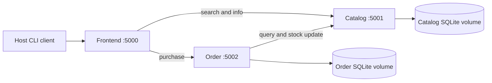

# Architecture

## Responsibilities

Frontend accepts user requests and forwards them over HTTP. It never opens either database. Catalog owns the four books, their topics, quantities and integer-cent prices. Order owns purchase receipts and queries/updates Catalog using the agreed REST API. The host client prints user-friendly results.

## Purchase flow

1. The client sends POST /purchase/2 to Frontend.
2. Frontend sends POST /purchase/2 to Order.
3. Order queries Catalog for the book, then requests stock_delta=-1.
4. Catalog starts a write transaction, checks current quantity and decrements only if enough stock remains.
5. Order saves the receipt and returns HTTP 201. The client prints bought book followed by the title.

Concurrent decrements cannot take quantity below zero. The Catalog update and Order insert remain separate transactions: failed storage triggers an attempted compensation, while crashes or ambiguous timeouts may still need reconciliation. No exactly-once purchase guarantee is claimed.

## Deployment and data

Docker Compose creates three Linux containers. Only Frontend is published to the host; backend URLs use Compose service names. Each backend uses its own persistent named volume. down preserves these volumes; down -v intentionally deletes them. Local desktop databases are separate from Docker data.

See the [full report](../design.pdf) for tradeoffs, known failure cases and possible idempotent reservation/recovery extensions.
